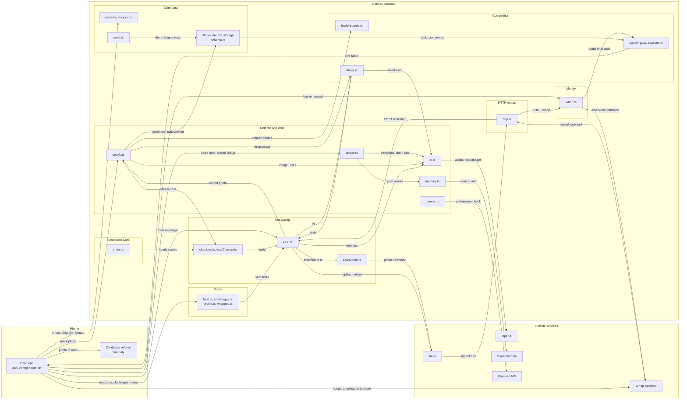

# Lineup architecture

Lineup is one Expo app and one Convex backend. The backend holds all state and makes every call to an outside service; the app renders queries and sends mutations and actions. Main calls five outside services: OpenAI, Supermemory, Whop (sandbox only), Keiki, and the Canvas LMS API for coursework proofs.

Every statement here was checked against main on November 15, 2026. Paths are relative to the repository root.

## System diagram

The app calls public functions in every backend module, and every module reads and writes the tables. Only the main flows are drawn.

## Boundary rules

1. **Outside calls happen only in Convex actions.** No file under `app/`, `components/`, `lib/`, `theme/` or `modules/` imports `openai`, `supermemory` or `@whop/sdk`, so no key reaches a phone. The app's only `fetch` is `uploadToConvex` in `components/capture/uploadToConvex.ts`, which posts media to Convex file storage. The app does open two outside pages itself: Whop's hosted checkout (`components/roster/PayBanner.tsx`) and a Messages link (`components/keiki/PlayByTextRow.tsx`).
2. **One file per service.** The OpenAI SDK is imported only in `convex/ai.ts`, Supermemory only in `convex/memory.ts`, the Whop SDK only in `convex/whop.ts`. Keiki is called only from `convex/keiki.ts` and `convex/keikiMedia.ts`, Canvas only from `convex/canvas.ts`. Keys, timeouts and failure handling for a service are then in one place. (`chat` in `convex/keiki.ts` posts to a path named `/openai/chat/completions`; that is Keiki's gateway, not OpenAI.)
3. **`convex/http.ts` only routes.** It is 15 lines. The handlers are `whopWebhook` in `convex/whop.ts` and `keikiTurn` in `convex/keiki.ts`, and each checks a signature on the raw body before parsing it.
4. **The server decides who is calling.** Public queries and mutations call `requireUser` in `convex/lib/auth.ts`, which honours `users.demoActAs` (the demo's Switch Player). Actions have no database, so each resolves its caller through an internal query that calls `requireUser`, for example `callerId` in `convex/lineup.ts` and `context` in `convex/proofs.ts`. Exceptions on main: `reset` and `players` in `convex/seed.ts` check no caller at all, so any client can reset the demo league. `createUser`, `actAs`, and Keiki's `line` and `setOptIn` act on the device's own account on purpose.
5. **`convex/lib/` is pure.** Its files take plain data and return plain data: no database, storage, network, environment or clock. The one exception is `convex/lib/auth.ts`, which reads the `users` table. Each file has a `*.test.ts` beside it except `auth.ts` and the generated `seedPhotos.ts`. Not every pure rule lives there: `challenges.ts`, `feed.ts`, `profile.ts`, `wrapped.ts`, `canvas.ts` and `leadChange.ts` keep their rules at the top of their own file.
6. **Scoring, the week and settlement have one definition each.** Points come from `scoreWeek` in `convex/lib/scoring.ts`, a league table from `leagueStandings` in `convex/standings.ts`, a week start from `weekStartOf` in `convex/lib/week.ts`, and payouts from `computeSettlement` in `convex/lib/settlement.ts`. Two small gaps: the client steps weeks with its own `shiftWeekStart` in `lib/week.ts`, and `ordinal` is written three times (`convex/wrapped.ts`, `convex/lib/ranking.ts`, `convex/lib/keikiText.ts`).
7. **Only `convex/keiki.ts` sends a text.** Other modules schedule `internal.keiki.send` and never await it, so a failed text cannot undo a proof, a vote or a drop.
8. **`convex/schema.ts` is the contract.** Its header asks for new fields to be optional and index names to stay fixed. This is a convention: `convex/schema.test.ts` only checks that the shared tables exist. The app mirrors part of the contract by hand in `lib/backend.ts`, `components/capture/backend.ts` and `components/social/contract.ts`, so those types are not checked against the backend by the compiler.
9. **`app/` holds routes only.** All 23 files are routes or layouts, and 15 of them are eight lines or fewer and mount a screen from `components/`. A few keep their screen inline; the largest is `app/contacts.tsx` at 131 lines.
10. **The on-device referee never awards points.** `precheck` in `lib/onDeviceReferee.ts` returns a hint; only `record` in `convex/proofs.ts` marks a task verified.

## Modules

### HTTP routes

**`convex/http.ts`** mounts the Convex Auth routes, `POST /whop` and `POST /keiki/turn`. It is separate so everything reachable from the internet is listed on one screen.

**`convex/auth.ts`** configures Convex Auth with one provider, anonymous sign-in, and one-year sessions. An account is a device-bound session; `createUser` in `convex/users.ts` stores the phone number a player types without verifying it. `convex/auth.config.ts` and `convex/convex.config.ts` are configuration; the second declares every environment variable as optional, so a missing key fails one feature and not the deploy.

### Core data

**`convex/schema.ts`** defines every table, index and shared validator. Lineups, tasks and proofs are keyed by `(userId, weekStart)`, not by league, because one lineup scores in every league a player is in.

**`convex/lib/auth.ts`** holds `signedInUser`, `requireSignedInUser` and `requireUser`. It is separate so "who is calling" has one answer, and Switch Player works by changing that one answer.

**`convex/users.ts`** owns the `users` row: `me`, `createUser` (name and phone at onboarding) and `matchContacts`.

**`convex/leagues.ts`** owns leagues, memberships, weeks and matchups: `create`, `joinByCode`, `quickMatch`, `get`, and the helpers other modules import (`currentWeek`, `addMember`). A league's latest `weeks` row, not the calendar, is its current week. No scheduled job opens a new week: `ensureCurrentWeek` runs when a member joins, and the internal `startWeek` has no caller on main.

**`convex/seed.ts`** rebuilds the demo league in place (`reset`) and powers Switch Player (`players`, `actAs`). **`convex/lib/seedPhotos.ts`** embeds the demo's generated proof photos as base64, because a Convex function cannot read files from the repository.

### Referee and draft

**`convex/ai.ts`** is five plain helpers: `transcribe`, `draftLineup`, `rateTask`, `judgeProof` and `askJson`. It is the only OpenAI file, so each prompt sits beside the schema the model must fill and no other module sees the SDK.

**`convex/memory.ts`** wraps Supermemory with `searchMemories` and `addMemory`, namespaced by user id. Memory is best-effort: a search that fails or passes its four-second cap returns an empty list, so a draft never waits on it.

**`convex/lineup.ts`** drafts and stores the week. `draft` turns a voice note into proposed tasks and saves nothing; `lock` stores them; `roster` reads them back. **`convex/lib/lineupRules.ts`** holds the shape rules (five core slots, at most three flex tasks) in pure code, because the model is only asked to follow them and the lineup carries money.

**`convex/proofs.ts`** runs one verification path for the app (`verify`) and for texted photos (`verifyForUser`). The model describes the photo; **`convex/lib/verdict.ts`** decides (`decideVerdict`: fail below 0.6 confidence), **`convex/lib/geo.ts`** holds the 150 m check-in rule, and **`convex/lib/clip.ts`** reads a clip's length so the 10-second limit holds on the server. The model does not read video: the app samples up to three stills, and a texted video is turned away.

**`convex/canvas.ts`** verifies a coursework task by asking Canvas whether the assignment was handed in. It is separate because the Canvas access token must never leave the server. `demoSchool` answers for the seeded player, so the demo needs no real token.

### Money

**`convex/whop.ts`** carries every dollar: `createCheckout` opens a hosted checkout on the league's own Whop company, `whopWebhook` is the only thing that marks a member paid, and `settleWeek` writes ledger rows in one transaction (`closeWeek`) before sending any transfer. `whopClient` refuses to run unless the environment is set to sandbox. Per the comment in `settleWeek`, Whop refuses transfers out of unverified sandbox companies, so payouts are shown from ledger rows. No job ends a week; a member presses End Week Now in the demo controls.

**`convex/lib/settlement.ts`** is the payout maths in whole cents (`computeSettlement`), and **`convex/lib/projection.ts`** forecasts a payout by calling it, so a projection cannot disagree with the settlement.

### Messaging

**`convex/keiki.ts`** is the league agent players text. Inbound texts (`keikiTurn`), outbound texts (`send`) and the in-app chat (`chat`) all meet in `answerTurn`, so a command means the same thing everywhere. Limits from its header: the shared number has no group chats, so a league text goes to each member one-to-one, and the agent can only text a player who texted it first and opted in. **`convex/lib/keikiProtocol.ts`** is the wire format and signature check; **`convex/lib/keikiText.ts`** is every command and sentence.

**`convex/keikiMedia.ts`** downloads a texted attachment, converts HEIC to JPEG and stores it. It is separate because it needs Node libraries and so runs under `"use node"`. **`convex/lib/mediaType.ts`** names a file by its leading bytes.

**`convex/checkins.ts`** asks for the check-in instead of waiting: one prompt on Roster, an hourly `sweep`, and a text to whoever a prover just passed. **`convex/lib/checkinRules.ts`** decides which prompt, the quiet hours and the three-texts-a-day cap. Arrival at a pinned place is detected only while the app is open (`components/checkin/useForegroundCoords.ts`).

**`convex/leadChange.ts`** texts a league when its lead changes hands. It is separate because standings are not stored, so it keeps the one remembered fact, `leagues.leaderId`.

### Social

**`convex/feed.ts`** lists verified proofs with the referee's reason, reactions and close calls. **`convex/challenges.ts`** lets a member challenge a proof and the league vote; the hold is the task's status, so held points leave the standings with no separate ledger. **`convex/profile.ts`** and **`convex/wrapped.ts`** compute lifetime stats and the week's recap cards on read and store nothing.

### Competition

**`convex/lib/scoring.ts`** is every points rule, and **`convex/lib/week.ts`** is the Monday-to-Sunday Pacific week. Both are pure so standings can be recomputed inside a reactive query.

**`convex/standings.ts`** computes the league table, the matchup and the pot on every read. `leagueStandings` is the one function other modules call for a table.

**`convex/seasons.ts`** assembles a season's schedule, table and bracket on read. **`convex/lib/schedule.ts`** holds the formats (round robin, double round robin, bracket) as ids in, pairings out.

**`convex/leaderboards.ts`** serves every ranking and the earnings projection. It owns `scores`, the only stored copy of a score, kept current by `refresh` after each proof. **`convex/lib/weekTally.ts`** reduces a week to the numbers a board ranks by, and **`convex/lib/ranking.ts`** words each row.

**`convex/drops.ts`** owns the two bonus features: quick-time drops and group sessions. A drop opens and closes through scheduled functions, and its tasks are ordinary `tasks` rows. **`convex/lib/dropRules.ts`** holds durations and text wording.

### Scheduled work

**`convex/crons.ts`** declares the one recurring job: the hourly check-in sweep. One-off timing (a drop closing, a vote closing, follow-ups after a proof) is scheduled by the module that owns it.

### The client

- **`app/`** is Expo Router routes: `app/(tabs)` holds Roster, Matchup, Feed and League, and the other folders are single screens (`draft`, `proof`, `task`, `group`, `chat`, `canvas`, `leaderboards`, `league-settings`, `profile`, `wrapped`, `demo`).
- **`components/`** holds the screens by area: `capture` (voice draft, camera, verdict, drops, demo controls), `social` (feed, matchup, profile, wrapped, chat, group, canvas), `roster`, `leagueTab`, `league`, `join`, `leaderboards`, `checkin`, `keiki`, `shell`, and `ui` for shared primitives. Screen logic sits in pure files with tests beside the components.
- **`lib/`** is client helpers: the Convex client (`lib/convex.ts`), keychain session storage (`lib/tokenStorage.ts`), the current-league context and small text helpers.
- **`theme/`** is the design tokens, so no screen hard-codes a colour or size.
- **`modules/on-device-referee`** is the JavaScript side of an Apple Vision pre-check. Its Swift half is not in the repository on main, so the module resolves to null and `precheck` returns nothing. The feature is wired in and inactive.

## Following one proof through the system

1. **Camera.** `app/proof/[taskId].tsx` mounts `ProofCamera`. After the shot, `verdictHref` in `components/capture/proofRoute.ts` routes to the verdict screen, which starts `useSubmitProof`.
2. **Upload.** `submitProof` in `components/capture/verdict/submitProof.ts` asks `generateUploadUrl` in `convex/proofs.ts` for an upload URL, and `uploadToConvex` posts the photo to Convex file storage.
3. **Checks before the model.** The `verify` action in `convex/proofs.ts` loads the task through `context`, which calls `requireUser` and confirms the task is the caller's and still open. `rejectionBeforeJudging` turns away a check-in that is too far from its place or a file the model cannot read.
4. **Referee.** `judgeProof` in `convex/ai.ts` sends the image URL to OpenAI and gets back a description. `decideVerdict` in `convex/lib/verdict.ts` turns it into the verdict.
5. **Write.** `record` in `convex/proofs.ts` inserts the `proofs` row and, on a pass, sets the task to verified in the same transaction. It then schedules the drop bonus, the lead-change check, the passed-rival text and the leaderboard refresh.
6. **Second phone.** `app/(tabs)/league.tsx` subscribes to `table` in `convex/standings.ts`. Convex reruns the query because the rows it read changed; `leagueStandings` recomputes each member with `scoreWeek`, and the new table reaches the phone. Nothing is stored for the table and no push notification is involved.
