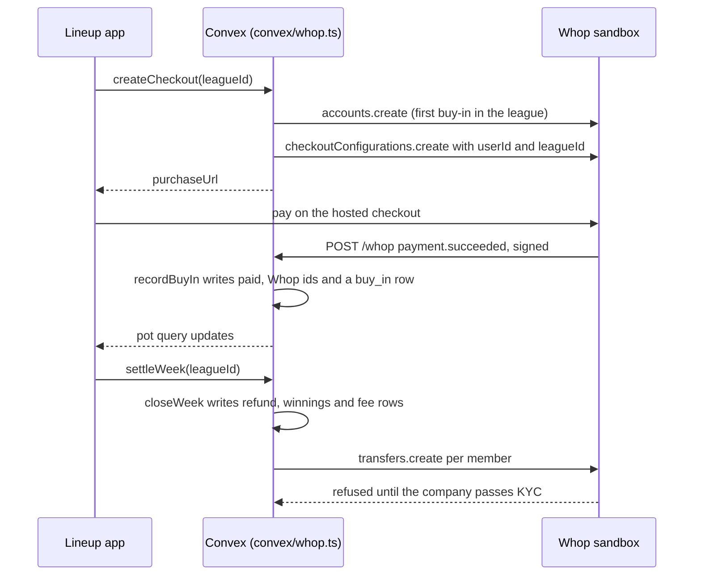

# Lineup on Whop

The case for the Whop track, written from the code on `main` on November 15, 2026. Each claim names the file that backs it.

## The case

A Lineup league is a group of friends who each put in a stake for the week and get it back by a fixed rule. A Whop company has the same shape: its own balance, its own members, payments in and transfers out. So each league is its own Whop company under the platform account, each buy-in is a Whop checkout on that company, and settlement is written as transfers from that company to each player's Whop user. The stake is the product: "clear your five and you keep your money; score the most and you take everyone else's" (`convex/lib/settlement.ts`) only matters when a real payment decides who is in the pot. Today this runs in the Whop sandbox only, and payouts stop at the ledger because the sandbox refuses the transfers.

## What flows through Whop

Every Whop request is made from `convex/whop.ts`. The app never imports the SDK.

1. **League company.** On the first buy-in in a league, `openLeagueCompany` calls `accounts.create` with the title `Lineup · {league name}` and `external_id: league:{leagueId}`, and `saveLeagueCompany` stores the id on `leagues.whopCompanyId`. The external id keeps it to one company per league when two members pay at once.
2. **Checkout.** `createCheckout` calls `checkoutConfigurations.create` on the league's company: a one-time USD price equal to the stake, with metadata `{ userId, leagueId }`. `buyInFor` first refuses non-members, free leagues, members who have already paid, and a weekly league whose week is settled. The Pay banner (`components/roster/PayBanner.tsx`) opens the returned link in the in-app browser.
3. **Webhook.** Whop posts `payment.succeeded` to `POST /whop` (`convex/http.ts`, handler `whopWebhook`). The handler verifies the raw body with the SDK's `unwrapWebhook` and the webhook secret before parsing. It answers 503 while the secret is unset and 401 to a wrong secret, a changed body or a missing signature. `paidBuyIn` keeps only `payment.succeeded` events that carry both metadata ids; other verified events get a 200 and are ignored.
4. **Paid, identity, ledger.** `recordBuyIn` does this in one transaction: sets `memberships.paid`, stores the payment id, stores the payer's member id in the league company (`memberships.whopAccountId`) and their Whop user id (`users.whopUserId`), and inserts a `buy_in` ledger row keyed `buy_in:{paymentId}`. A repeated delivery finds that key and changes nothing. The member record is the member's sub-account in the league company: Whop creates it at checkout, so there is no separate call and no separate Whop login.
5. **Pot.** `pot` in `convex/standings.ts` is the sum of the current week's `buy_in` rows. It is a reactive query, so each phone shows the new total when the row is written.
6. **Settlement.** `settleWeek` calls `closeWeek`, which applies `computeSettlement` (`convex/lib/settlement.ts`) in whole cents:
   - The pot is the stake times the members with a `buy_in` row. Unpaid members are left out: they neither win nor forfeit.
   - A finisher (all five roster slots cleared) gets the stake back. A non-finisher forfeits it.
   - The fee is 10% of the forfeited stakes (`PLATFORM_FEE_RATE = 0.1`), rounded to the cent. Finishers split the other 90% in proportion to their points.
   - `splitByWeight` rounds each share down, then gives the leftover cents to the largest fractions, the earlier member first on a tie. Equal points split evenly and an odd cent goes to the earlier member. If no finisher has points, the split is even.
   - No finishers: every stake is refunded and no fee is taken. Everyone finishes: refunds only. Free league: nothing moves.
   - From the tests: a $20 stake, six paid, two finishers on 300 and 100 points. $80 is forfeited, the fee is $8, and the winnings are $54 and $18.
7. **Ledger rows.** `settlementLedgerRows` gives a `refund` row per paid-out member, a `winnings` row when it is above zero, and one `fee` row with no user. Keys are `{scope}:{userId}:refund`, `{scope}:{userId}:winnings` and `{scope}:fee`. `closeWeek` inserts them and marks the week settled in the same transaction.
8. **Transfers.** For each member with a Whop user, `settleWeek` sends one `transfers.create` from the league company to that user for refund plus winnings, with `idempotence_key` `{scope}:{userId}`. `recordTransfer` stamps the transfer id on the rows it paid.

The scope is the week id. A league set to season payout uses `{leagueId}:season` instead: `closeWeek` holds every stake until the final week (`isFinalWeek` in `convex/lib/schedule.ts`) and settles once on season totals. A stake buys into one settlement. When the next week or season opens, `ensureCurrentWeek` in `convex/leagues.ts` clears `memberships.paid`, so every member owes again.



## What is real today

Against the Whop sandbox, as read from the shared dev deployment's tables at 12:28 PM Pacific on November 15:

- Two `buy_in` ledger rows carry a payment id issued by Whop, with the payer's Whop member id on the membership and Whop user id on the player. This matches the Whop thread's report of a sandbox card payment going through checkout, the webhook and the ledger.
- The two leagues those payments belong to each hold a Whop company id.
- The deployed `POST /whop` answers 401 to an unsigned request.
- No `refund` or `winnings` row carries a Whop transfer id.

Computed in Convex and recorded in the ledger only:

- The split, the `refund`, `winnings` and `fee` rows, and the Payouts list on the League tab.
- The fee. It is a ledger row; no code moves it to the platform account.
- The seeded demo league's pot. Its six $20 buy-ins are seeded rows with no Whop id (`convex/seed.ts`).
- The earnings projection: `projection` in `convex/leaderboards.ts` calls `projectPayout` (`convex/lib/projection.ts`), which runs `computeSettlement` on the standings as they are.

## What the sandbox could not do

- **Transfers out.** Whop refuses a transfer out of a company that has not passed identity verification, and no sandbox league has (comment in `settleWeek`, pull request #65). `settleWeek` logs the refusal, leaves the ledger rows without a transfer id and retries under the same key on the next call. The League tab shows payouts from the ledger. The stakes stay in the league company's sandbox balance.
- **Webhook scope.** Only a webhook created with `child_resource_events` on receives a league company's payments (comment on `whopWebhook`). That registration is not in the repository; the Whop thread reports making it through the API.
- **Sandbox only.** `whopClient` throws unless the environment is explicitly the sandbox. Nothing has run against production Whop.

Limits in the code itself:

- Settlement runs only when a member taps End Week Now. No scheduled job calls `settleWeek` (`convex/crons.ts`), and any member of the league may call it.
- A member with no Whop user, such as a seeded player, gets ledger rows and no transfer (`unsentTransfers`). The fee is never transferred either.
- The company is opened at the first buy-in, not when the league is created.
- `createCheckout` and `openLeagueCompany` have no unit test. The tests stub the network for transfers.

## Safety properties

- **Nothing unverified is accepted on `/whop`.** The signature is checked on the raw bytes before anything is parsed or written. Tests: `POST /whop` in `convex/whop.test.ts`.
- **A repeated event is recorded once.** `recordBuyIn` returns early when `buy_in:{paymentId}` is already in the ledger (`isInLedger`).
- **Settling twice pays nobody twice.** `closeWeek` writes only while the week is open and marks it settled in the same transaction. Each row has a unique key that is checked before insert. Each transfer carries an idempotence key, and rows already stamped with a transfer id are not sent again. Test: "run twice, it pays nobody twice".
- **Ledger rows sum to the pot.** "the rows always sum to the pot, whatever the league looks like" in `convex/lib/settlement.test.ts` checks 500 generated leagues; `convex/whop.test.ts` checks the stored rows against the buy-ins.
- **Unpaid members cannot win the pot.** `computeSettlement` drops unpaid entrants, and `entrantsOver` counts a member as paid only when the ledger holds their `buy_in` row for the weeks being settled. Test: "an unpaid member neither wins nor forfeits, even with the top score".
- **The API key lives only in the Convex deployment.** `whopClient` reads it from the typed `env` declared in `convex/convex.config.ts`. `@whop/sdk` is imported only by `convex/whop.ts`, and the committed `.env` holds only the public Convex URL.

## Check it yourself

```bash
npm ci
npm test -- settlement   # the split rule, rounding, rows sum to the pot
npm test -- whop         # signatures, duplicate delivery, settling twice, a refused transfer
curl -i -X POST https://sensible-guineapig-9.convex.site/whop -d '{}'   # 401: unsigned
```

In the app:

- **ROSTER** (`app/(tabs)/index.tsx`): an unpaid member of a staked league sees "Pay your $N buy-in". It opens the Whop sandbox checkout; the test card is 4242 4242 4242 4242.
- **LEAGUE** (`app/(tabs)/league.tsx`): the pot with PAID and UNPAID names (`components/leagueTab/PotSummary.tsx`), and the projection line under it.
- **End Week Now**: long-press the week label to open Demo controls (`components/capture/demo/DemoControls.tsx`). After it runs, LEAGUE shows a Payouts list with each refund and winnings row (`components/leagueTab/PayoutRows.tsx`).

The device runs of these steps are checks 3 and 6 in `docs/demo/ACCEPTANCE.md`; its status column records whether each has been run.
